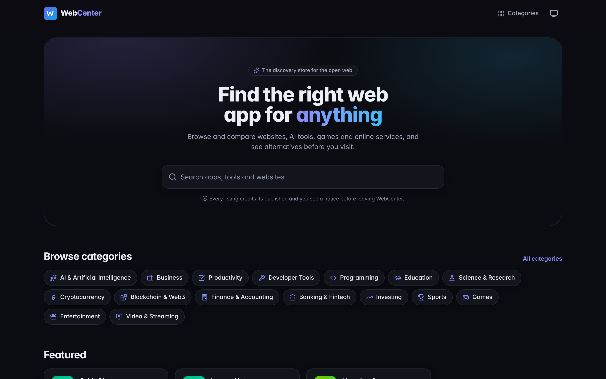
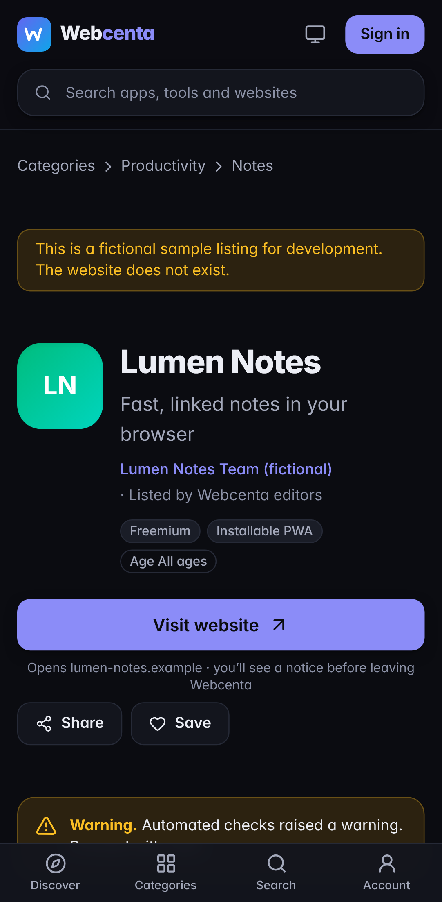
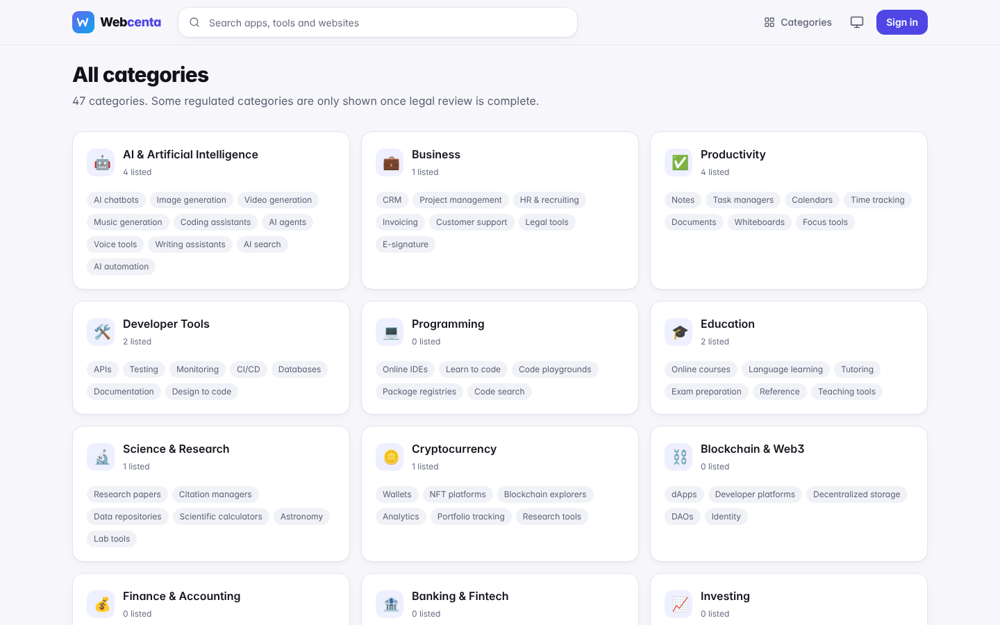
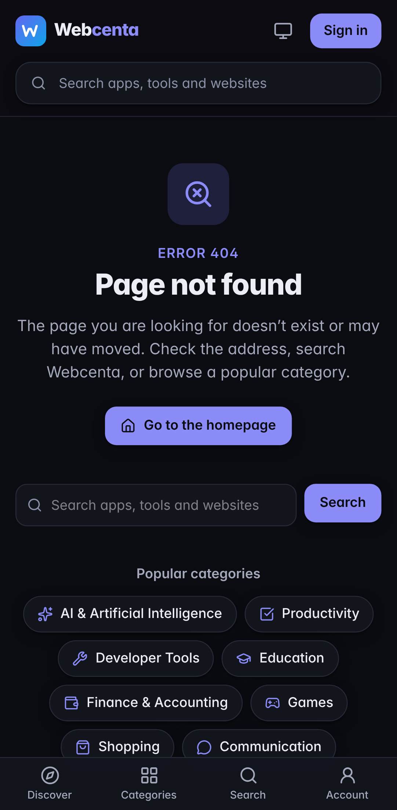

# Webcenta

**Webcenta** (`webcenta.com`) is a global discovery marketplace for websites, web applications,
online services, AI products and digital platforms. You browse, compare and safely visit web apps,
much as you would in an app store, but for the open web.

> **Status: all planned phases implemented and integration-tested (211 unit/DB tests, 112 E2E tests).
> Not deployed.** See [docs/FINAL_REPORT.md](docs/FINAL_REPORT.md) for evidence and unverified items.

| Desktop | Mobile |
| --- | --- |
|  |  |
|  |  |

## Stack

Next.js 16 (App Router) · React 19 · TypeScript · Tailwind CSS 4 · PostgreSQL (Supabase in
production, used as plain Postgres) · Prisma 7 · Vitest · Playwright + axe.
Hosting: Hostinger Business (Node.js), Hostinger Cron, GitHub. See [ADR-0007](docs/adr/0007-hostinger-supabase.md).

## Documentation

| Document | Contents |
| --- | --- |
| [docs/ARCHITECTURE.md](docs/ARCHITECTURE.md) | System design, host routing, key flows |
| [docs/DATABASE.md](docs/DATABASE.md) | Schema, hand-written SQL, Supabase safety (RLS), retention |
| [docs/SECURITY.md](docs/SECURITY.md) | Threat model, admin isolation, RBAC, SSRF-safe scanning, privacy |
| [docs/DEPLOYMENT.md](docs/DEPLOYMENT.md) | Hostinger + Supabase runbook, env vars, cron, migration path |
| [docs/ROADMAP.md](docs/ROADMAP.md) | Implementation status, open decisions |
| [docs/TESTING.md](docs/TESTING.md) | Test suites, E2E setup, the ten user journeys |
| [docs/FINAL_REPORT.md](docs/FINAL_REPORT.md) | Final verification report, risks, deployment summary |
| [docs/adr/](docs/adr/) | Architecture decision records |

## Local development

Requirements: Node.js ≥ 22, PostgreSQL ≥ 15.

```bash
cp .env.example .env                          # point DATABASE_URL at a local, disposable database
npm install                                   # also runs prisma generate
npx prisma migrate deploy                     # apply migrations
ALLOW_DEV_FIXTURES=true npm run db:seed -- --fixtures   # taxonomy + FICTIONAL sample listings
npm run dev                                   # http://localhost:3000
```

Admin portal: run `npm run admin:provision -- --email you@example.com`, open the printed link on
`http://admin.localhost:3000`, set a password and enrol TOTP. Scheduled jobs: `npm run jobs:tick`.

| Command | Purpose |
| --- | --- |
| `npm run lint` / `npx tsc --noEmit` | Lint and typecheck |
| `npm test` | Unit and database integration tests (needs a migrated and seeded DB) |
| `npm run build && E2E_DB_BASE=… bash tests/e2e/run-fresh.sh` | Production build and the full Playwright suite on a fresh DB (see docs/TESTING.md) |
| `npm run db:check` | Read-only compatibility report for a target DB (e.g. Supabase) |
| `npm run db:seed` | Seed real configuration (taxonomy, homepage sections, monitoring policy) |
| `npm run brand:check` | Fail if the retired product name appears anywhere |
| `npm run errors:generate` | Regenerate the static fallback error pages in `public/errors/` |

## Security

Never commit `.env` files, API keys, credentials or private keys. Report security issues privately
to the maintainers instead of opening a public issue.
